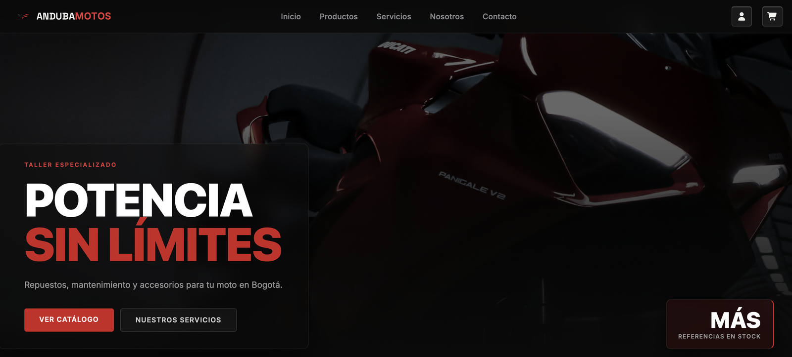
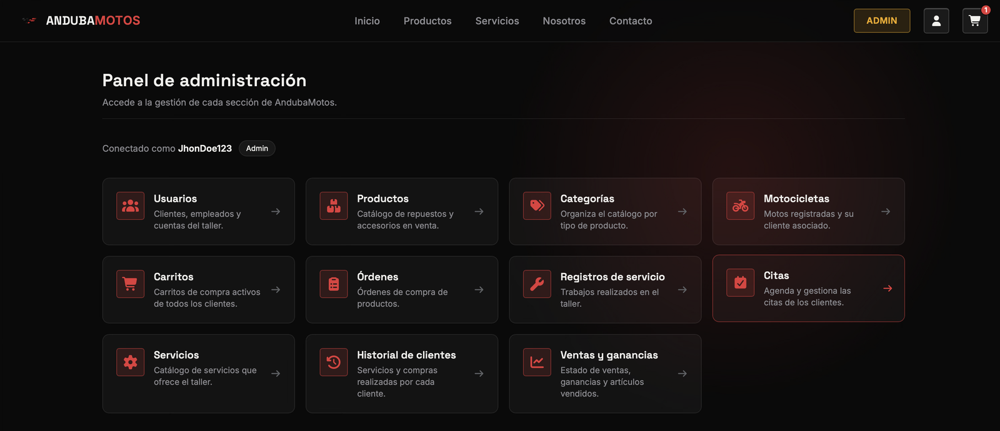
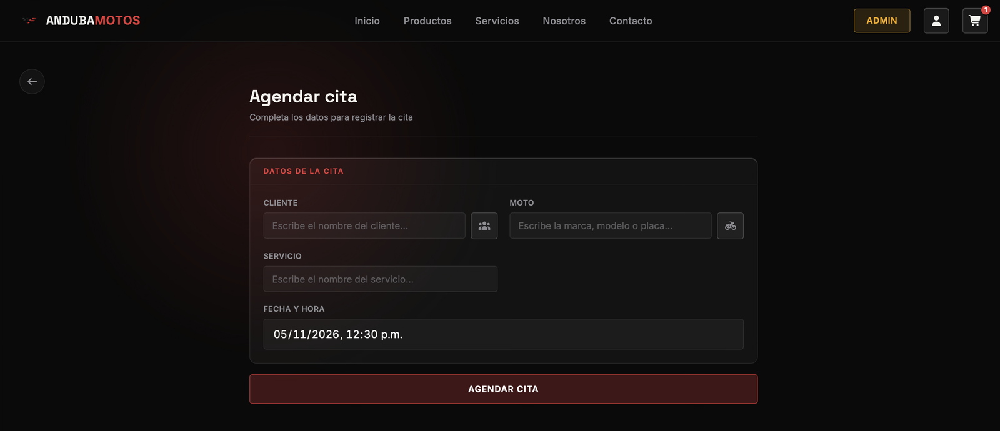
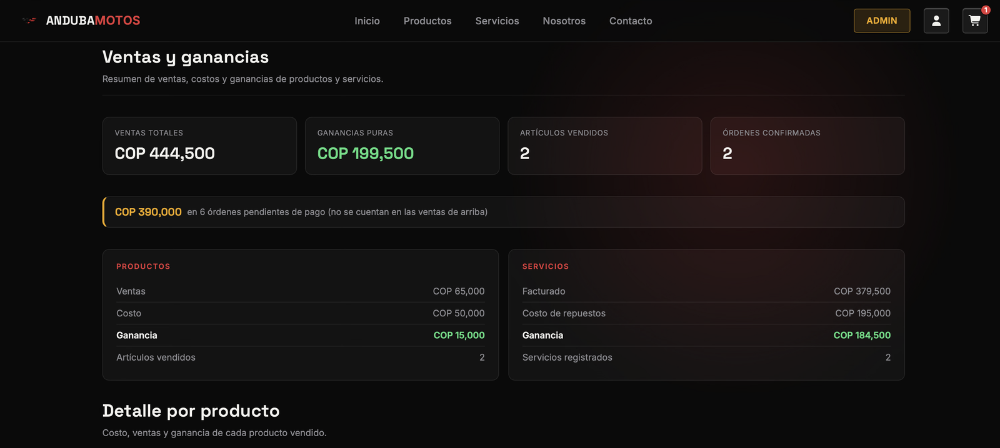

# 🏍️ Anduba Motos

Sistema web full-stack para la gestión de un taller de motos: tienda de repuestos, agendamiento de citas, registro de servicios realizados e historial por cliente, con un panel administrativo controlado por roles.


### 🔗 [Ver demo en vivo → anduba-motos-web.onrender.com](https://anduba-motos-web.onrender.com)

| Rol | Usuario | Contraseña | Qué puedes probar |
|---|---|---|---|
| Administrador | `demo_admin` | `Demo2026*` | Panel completo: usuarios, productos, citas, historial y reporte financiero |
| Cliente | `demo_client` | `Demo2026*` | Catálogo, carrito, registro de motos y agendamiento de citas |

> ⏳ **La primera carga puede tardar ~50 segundos.** La API usa el plan gratuito de Render, que la suspende tras 15 minutos sin uso; después de despertar responde con normalidad.



## 📸 Capturas

| Panel de administración | Agendamiento de citas |
|---|---|
|  |  |

**Reporte financiero:** ventas, costos y ganancias calculados con aggregation pipelines de MongoDB.



## ✨ Funcionalidades

**Para clientes**

- Registro, inicio de sesión y recuperación de contraseña por código enviado al correo
- Catálogo de productos y servicios, carrito de compras y checkout
- Registro de sus motos y agendamiento de citas en el taller
- Sección "Mi cuenta" con su información y su historial

**Panel administrativo** (roles `owner`, `admin` y `employee`)

- CRUD de usuarios, productos, categorías, motos, servicios y órdenes
- Gestión de citas con estados: `confirmada`, `aplazada`, `cancelada`
- Registros de servicio por moto e historial por cliente con filtros por fecha
- Reporte financiero: ventas, costos, ganancia y porcentaje de ganancia
- Vista de carritos activos
- Carga de imágenes de productos y servicios

**Seguridad y arquitectura**

- Autenticación con JWT y contraseñas cifradas con bcrypt
- Autorización por roles en el backend (middlewares) y en el frontend (guards)
- Middlewares de propiedad de recursos: un cliente solo puede ver o editar lo suyo
- Índices TTL en MongoDB para depurar órdenes y registros antiguos de forma automática
- Almacenamiento de imágenes intercambiable: disco local en desarrollo y Cloudinary en producción

## 🛠️ Stack

| Capa | Tecnologías |
|---|---|
| Frontend | Angular 22 (standalone components, signals, control flow `@if`/`@for`), RxJS, SweetAlert2, Font Awesome |
| Backend | Node.js, Express 5, Mongoose, JSON Web Token, bcrypt, Multer, Nodemailer |
| Base de datos | MongoDB (local o Atlas) |

## 📁 Estructura del proyecto

```
anduba-motos/
├── backend/                 # API REST (Node + Express + MongoDB)
│   ├── src/
│   │   ├── config/          # Conexión a Mongo y constantes globales (roles)
│   │   ├── controllers/     # Lógica de cada endpoint
│   │   ├── helpers/         # JWT, bcrypt, envío de correos
│   │   ├── middlewares/     # Autenticación, autorización, propiedad, Multer
│   │   ├── models/          # Esquemas de Mongoose
│   │   ├── routes/          # Definición de rutas /api/*
│   │   ├── services/        # Acceso a datos
│   │   └── index.js         # Punto de entrada
│   ├── uploads/             # Imágenes subidas (no se versionan)
│   └── .env.example
│
└── frontend/                # SPA en Angular
    └── src/app/
        ├── core/            # Guards, interceptor, modelos, pipes y servicios HTTP
        ├── features/        # Páginas: home, catálogo, citas, dashboard, historial...
        └── shared/          # Componentes reutilizables (header, footer...)
```

## 🚀 Cómo correrlo localmente

**Requisitos:** Node.js 22 o superior y MongoDB (local o una cuenta gratuita en MongoDB Atlas).

### 1. Clonar el repositorio

```bash
git clone https://github.com/johansr243-stack/anduba-motos.git
cd anduba-motos
```

### 2. Backend

```bash
cd backend
npm install
cp .env.example .env     # luego edita .env con tus valores
npm run dev              # API en http://localhost:3000
```

Variables de entorno (`backend/.env`):

| Variable | Descripción |
|---|---|
| `PORT` | Puerto de la API (por defecto 3000) |
| `JWT_SEED` | Clave para firmar los tokens |
| `DB_URI` | Cadena de conexión a MongoDB |
| `EMAIL_USER` / `EMAIL_PASS` | Cuenta de Gmail y contraseña de aplicación para enviar códigos de recuperación |
| `CLOUDINARY_CLOUD_NAME` / `CLOUDINARY_API_KEY` / `CLOUDINARY_API_SECRET` | Opcionales. Si están definidas, las imágenes se suben a Cloudinary; si no, se guardan en `backend/uploads/` |

### 3. Frontend

En otra terminal:

```bash
cd frontend
npm install
npm start                # App en http://localhost:4200
```

La URL de la API se configura en `frontend/src/environments/`.

## ☁️ Despliegue

| Parte | Servicio |
|---|---|
| Frontend (Angular) | Render · Static Site |
| API (Node + Express) | Render · Web Service |
| Base de datos | MongoDB Atlas |
| Imágenes | Cloudinary |

Scripts de apoyo en `backend/scripts/`:

- `npm run copy:db -- "<URI_ORIGEN>" "<URI_DESTINO>"`: copia todas las colecciones de una base a otra (sirve para crear o reiniciar la base de la demo).
- `npm run migrate:images`: sube a Cloudinary las imágenes de `uploads/` y actualiza sus rutas en la base de datos.

## 🔌 Endpoints principales

| Recurso | Ruta base |
|---|---|
| Autenticación | `/api/auth` |
| Usuarios y roles | `/api/users`, `/api/roles` |
| Productos y categorías | `/api/products`, `/api/category` |
| Carrito y órdenes | `/api/shoppingcar`, `/api/orders` |
| Motos | `/api/motorcycles` |
| Servicios y citas | `/api/services`, `/api/appointment` |
| Registros de servicio e historial | `/api/serviceRecord`, `/api/history` |
| Reseñas y reportes | `/api/reviews`, `/api/reports` |

Las rutas protegidas esperan el token en el header `Token`.

## 👥 Equipo

Proyecto desarrollado en equipo:

- **Johan Daniel Patiño** — [GitHub](https://github.com/johansr243-stack) · [LinkedIn](https://www.linkedin.com/in/johan-daniel-pati%C3%B1o-martinez/)
- **Amed Vanegas** — [GitHub](https://github.com/AmedVanegas)
- **José Duarte**

### Mi aporte (Johan Daniel Patiño)

- **Sistema de gestión de citas, de punta a punta:** modelo en Mongoose, controlador, servicios y rutas protegidas por rol en la API, y en Angular el formulario de agendamiento y el listado de citas con cambio de estado (`confirmada`, `aplazada`, `cancelada`) desde el panel administrativo.
- **Sección de contacto:** formulario reactivo con validaciones que carga los servicios del taller y las motos del cliente que inició sesión, para que pida su cita en pocos pasos.
- **Control financiero del administrador:** reporte de ventas con ingresos, costos, ganancia y porcentaje de ganancia, calculados con *aggregation pipelines* de MongoDB a partir de las órdenes confirmadas. El costo de cada producto se guarda al momento de la venta, así que los reportes no cambian aunque después se actualicen los precios.
- **Página principal:** diseño y maquetación de la portada (hero, secciones de servicios y productos destacados) con la identidad visual del taller.

Repositorios originales del equipo: [backend](https://github.com/AmedVanegas/Nuevo-backend-AndubaMotos) · [frontend](https://github.com/AmedVanegas/FrontEnd-Andaba-Motos)
